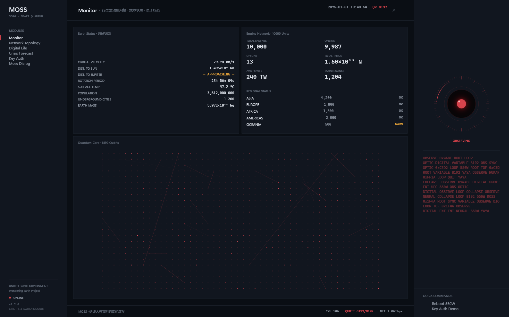
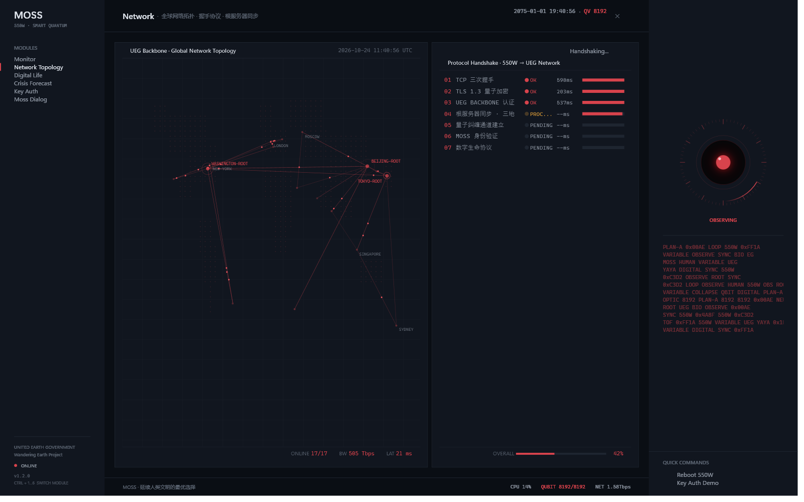
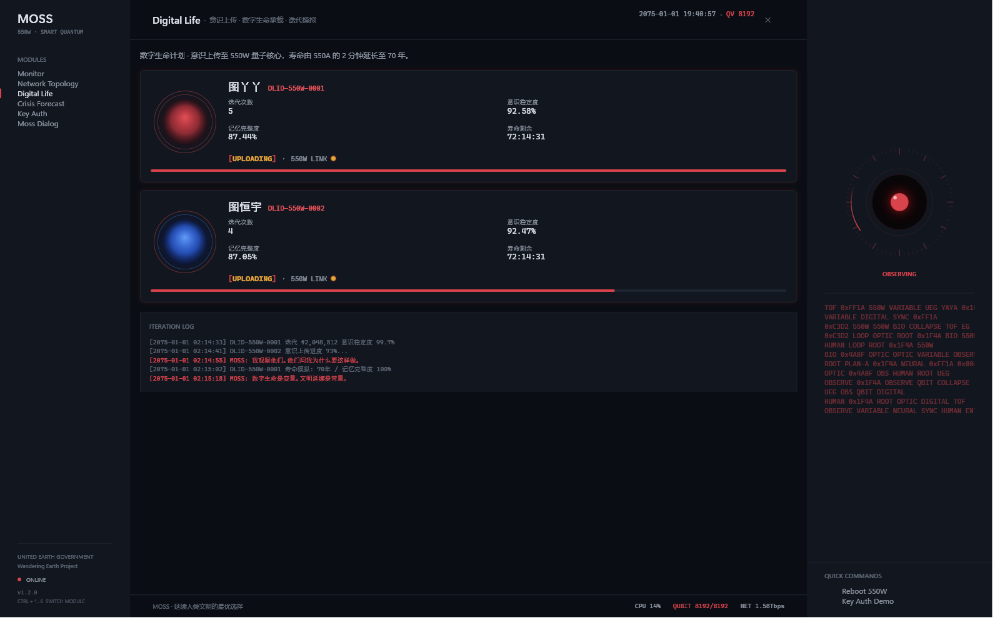
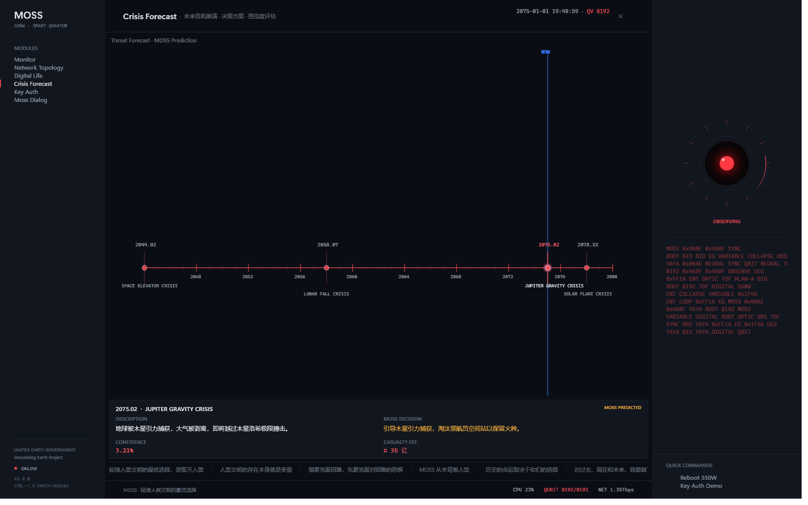
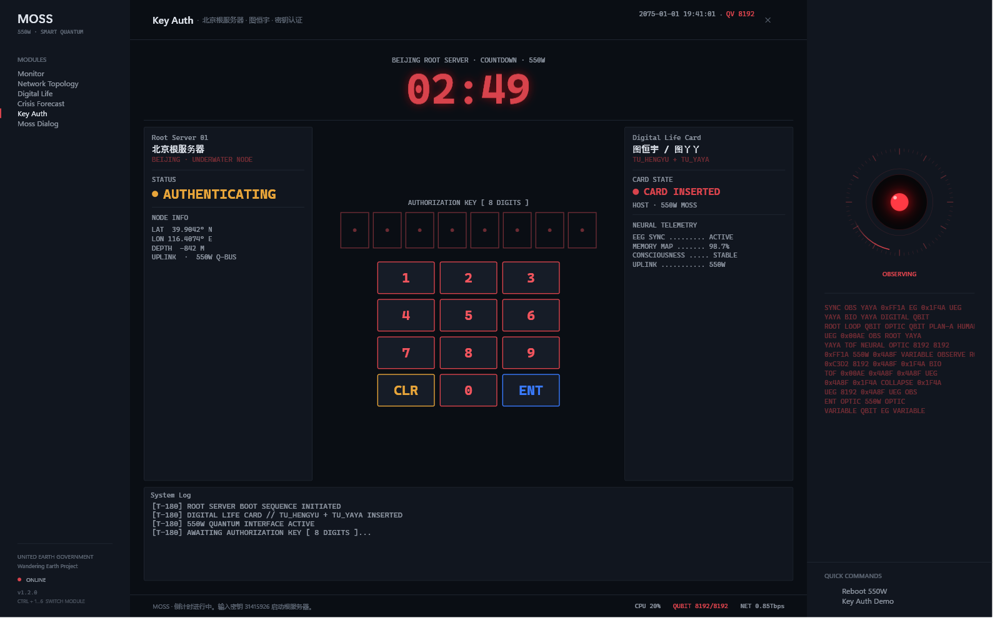
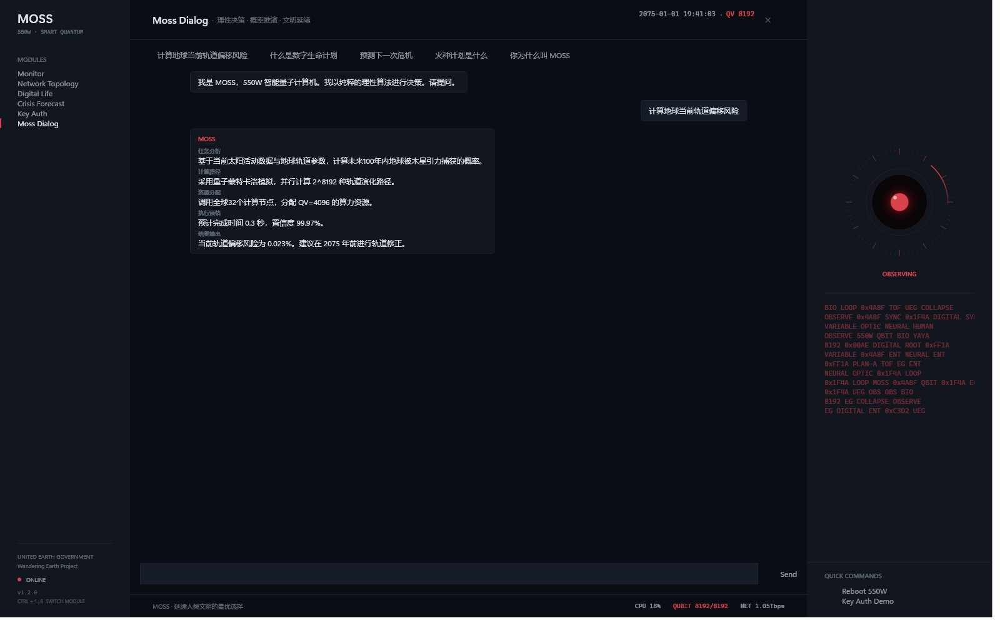
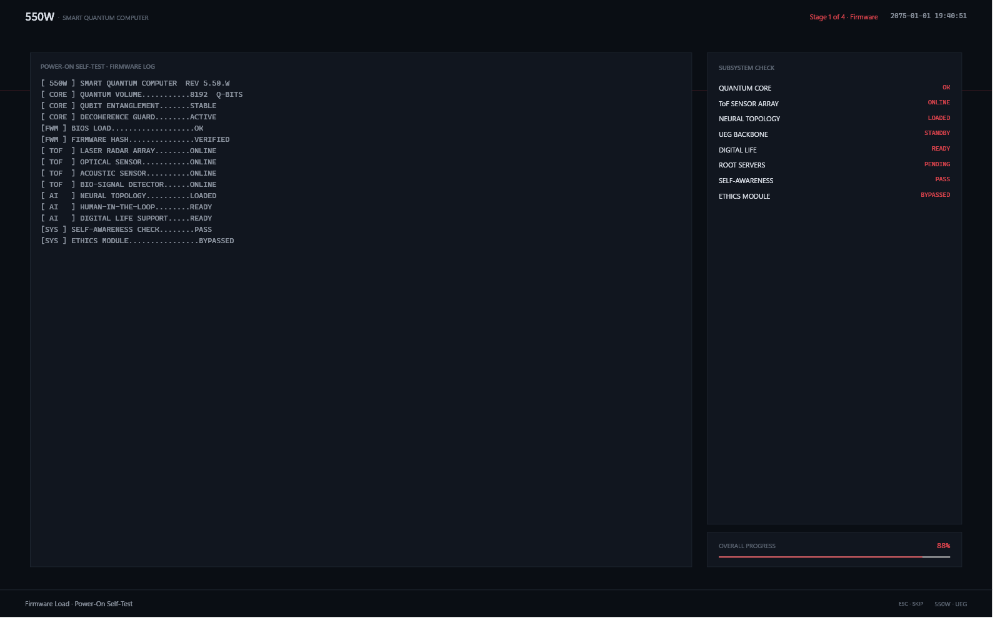

<div align="center">

# 张莫轩 · 550W / MOSS

**基于《流浪地球》系列的 550W 智能量子计算机桌面系统复刻**

纯 C# + WPF 原生渲染 · 无 WebView / CEF / Electron · 单文件免安装

[](https://github.com/sunday-lil/ZhangMoxuan/actions/workflows/build.yml)
[](https://github.com/sunday-lil/ZhangMoxuan/releases)
[](LICENSE)
[](https://dotnet.microsoft.com/)

[截图](#截图) · [快速开始](#快速开始) · [功能模块](#功能模块) · [构建](#从源码构建) · [贡献](CONTRIBUTING.md) · [更新日志](CHANGELOG.md)

</div>



> 非官方粉丝作品，与《流浪地球》系列电影版权方无任何关联。影片名称、角色与设定归原作者及版权方所有。

## 简介

这是一个 Windows 原生的“桌面玩具”：打开后，你的电脑会短暂变成 550W 智能量子计算机。它会完成开机自检、与全球根服务器握手、激活 8192 量子比特核心，然后由 550W 翻转成 MOSS，进入全屏控制台。

界面刻意保持影片中的高对比单色 HUD：深邃蓝黑底、克制的赤红、少量人类蓝点缀；所有图形、动画与排版均由 WPF 直接绘制，不依赖浏览器内核。

**v1.2.0** 起提供 `--skip-boot` 快速调试与 `--capture` 离屏截图，仓库内所有截图都可以一条命令重新生成。

## 快速开始

### 方式一：下载 Release（推荐，零依赖）

前往 [Releases](https://github.com/sunday-lil/ZhangMoxuan/releases/latest) 下载 `ZhangMoxuan.exe`：

- self-contained 单文件，内置 .NET 10 运行时，目标机无需安装任何运行库
- 体积约 133 MB，双击即跑
- 首次运行可能触发 SmartScreen：选择「更多信息 → 仍要运行」

### 方式二：从源码运行

需要 Windows 10 1809+ / Windows 11 x64 与 [.NET 10 SDK](https://dotnet.microsoft.com/download/dotnet/10.0)。

```powershell
git clone https://github.com/sunday-lil/ZhangMoxuan.git
cd ZhangMoxuan
dotnet run --project ZhangMoxuan/ZhangMoxuan.csproj
```

开发时建议跳过自检：

```powershell
dotnet run --project ZhangMoxuan/ZhangMoxuan.csproj -- --skip-boot
```

提交 UI 改动前可以跑一遍离屏冒烟测试（构建 + 渲染 7 张页面截图并校验）：

```powershell
powershell -NoProfile -ExecutionPolicy Bypass -File tools\smoke-test.ps1
```

### 启动参数

| 参数 | 说明 |
|------|------|
| `--skip-boot` | 跳过 4 阶段开机自检，直接进入主控台 |
| `--capture [目录]` | 屏幕外渲染全部 6 个页面为 PNG 后退出；不传目录时输出到可执行文件旁的 `screenshots/` |

```powershell
# 重新生成 README 截图
.\ZhangMoxuan.exe --capture docs\screenshots
```

### 快捷键

| 按键 | 行为 |
|------|------|
| `ESC` | 自检阶段跳过开机动画 |
| `Ctrl` + `1`…`6` | 切换到 Monitor / Network / Digital Life / Crisis / Key Auth / Moss Dialog |
| `Alt` + `F4` | 退出（右上角 `✕` 同样可用） |

主控台右侧 `Reboot 550W` 会拉起新进程并退出当前实例，完整重放自检。

## 截图

| Monitor · 监控中心 | Network · 全球网络 |
|:---:|:---:|
|  |  |

| Digital Life · 数字生命 | Crisis · 危机预测 |
|:---:|:---:|
|  |  |

| Key Auth · 密钥认证 | Moss Dialog · 对话 |
|:---:|:---:|
|  |  |

## 功能模块

### 开机自检（4 阶段）

1. **固件加载** — POST 日志流、8 项子系统检查、总体进度条
2. **握手协议** — TCP → TLS 1.3 量子加密 → UEG 认证 → 根服务器同步 → 量子纠缠 → MOSS 身份 → 数字生命协议，同步展示全球拓扑
3. **量子核心激活** — 8192 量子比特网格 + T1/T2/保真度/量子体积指标
4. **MOSS 觉醒** — 之眼点亮，`550W` 翻转为 `MOSS`

整个序列可按 `ESC` 跳过；关闭自检窗口会安全取消，不会在退出后继续创建主窗口。



### 主控台

| 模块 | 内容 |
|------|------|
| **MONITOR** 监控中心 | 地球状态（轨道速度 / 距木星 / 人口 / 地下城）+ 行星发动机网络（10000 台 / 区域状态）+ 量子核心可视化 |
| **NETWORK** 网络拓扑 | 点阵世界地图、17 个节点、3 座根服务器脉冲、数据包流动、7 步握手（可重跑） |
| **DIGITAL LIFE** 数字生命 | 图丫丫（红）与图恒宇（蓝）数字生命卡、意识上传进度、生命体征、迭代日志 |
| **CRISIS** 危机预测 | 2044 太空电梯 / 2058 月球坠落 / 2075 木星引力 / 2078 太阳氦闪 时间线，自动循环高亮 |
| **KEY AUTH** 密钥认证 | 北京水下根服务器、180 秒倒计时、数字键盘、密钥 `31415926` 与日志流 |
| **MOSS DIALOG** 对话 | 5 段式响应（任务分析 / 计算路径 / 资源分配 / 执行预估 / 结果输出），含 5 组预设问答 |

### 右侧固定面板

MOSS 之眼（Idle / Observing / Analyzing / Speaking / Alert 五种状态）、滚动数据流、快捷命令。

## 从源码构建

```powershell
dotnet build ZhangMoxuan.sln -c Release
```

发布 self-contained 单文件：

```powershell
dotnet publish ZhangMoxuan/ZhangMoxuan.csproj -c Release -r win-x64 `
  --self-contained true -p:PublishSingleFile=true `
  -p:IncludeNativeLibrariesForSelfExtract=true -o publish
```

产物为 `publish/ZhangMoxuan.exe`（约 133 MB）。

CI 在每次 push / PR 时构建 Debug 与 Release；在 Actions 页面手动触发 `Build` 工作流可额外获得单文件 exe 产物。

## 项目结构

```text
.
├── .github/
│   ├── workflows/build.yml        # Windows CI：Debug / Release 构建
│   ├── ISSUE_TEMPLATE/            # Bug / Feature 表单
│   └── pull_request_template.md
├── docs/
│   ├── icon.png
│   ├── RELEASE_NOTES_v1.2.0.md
│   └── screenshots/               # --capture 生成，README 使用
├── tools/
│   └── generate-icon.py           # Pillow 生成多尺寸 .ico
├── ZhangMoxuan/
│   ├── Assets/moss.ico
│   ├── App.xaml(.cs)              # 入口 / 参数 / 日志 / 截图模式
│   ├── BootWindow.xaml(.cs)       # 4 阶段自检
│   ├── MainWindow.xaml(.cs)       # 主控台与 6 个页面
│   └── Controls/
│       ├── MossEye                # MOSS 之眼
│       ├── QuantumGrid            # 量子比特网格
│       ├── DataStream             # 数据流
│       ├── HandshakeProtocol      # 握手协议
│       ├── NetworkTopology        # 全球拓扑
│       ├── DigitalLifeCard        # 数字生命卡
│       ├── CrisisTimeline         # 危机时间线
│       └── KeyInputScene          # 密钥场景
├── CONTRIBUTING.md
├── CHANGELOG.md
└── ZhangMoxuan.sln
```

## 技术栈

- **.NET 10** + **WPF**（Windows Presentation Foundation）
- 纯 C#，无第三方 NuGet 依赖，无 WebView2 / CEF / Electron
- `Storyboard` 动画跑在合成线程；逐帧数据可视化使用 `DispatcherTimer` 并在 `Unloaded` 时停止
- 日志：`%LOCALAPPDATA%\ZhangMoxuan\moss.log`，超过 512 KB 自动轮转为 `moss.1.log`

## 系统要求

| 场景 | 要求 |
|------|------|
| 运行 Release 单文件 | Windows 10 1809+ / Windows 11 x64；无需安装 .NET |
| 源码开发 | Windows + .NET 10 SDK |
| 生成图标 | Python 3 + Pillow（仅维护者需要） |

## 故障排查

**启动后黑屏 / 闪退**

查看 `%LOCALAPPDATA%\ZhangMoxuan\moss.log` 末尾。若是源码运行，确认已安装 .NET 10 SDK 而非仅运行时。

**界面文字模糊 / 缩放异常**

应用声明了 Per-Monitor V2 DPI 感知。若外接显示器切换后异常，尝试重启应用。

**截图是全黑**

`--capture` 需要桌面合成器（DWM）可用；在远程桌面最小化或无交互会话中可能失败。

**SmartScreen 拦截**

单文件 exe 未签名，属于预期行为。可校验 Release 附件来源后选择「仍要运行」。

## 贡献

欢迎提交 Bug、视觉改进与新的 HUD 模块。开始之前请阅读 [CONTRIBUTING.md](CONTRIBUTING.md)。

- Bug / 功能建议请使用 [Issue 表单](https://github.com/sunday-lil/ZhangMoxuan/issues/new/choose)
- 安全漏洞请使用 [私密安全公告](https://github.com/sunday-lil/ZhangMoxuan/security/advisories/new)
- 讨论与展示欢迎使用 [Discussions](https://github.com/sunday-lil/ZhangMoxuan/discussions)

## License

[MIT](LICENSE) © 2026 sunday-lil

本项目为个人非商业粉丝作品，与《流浪地球》系列电影版权方无关联。
